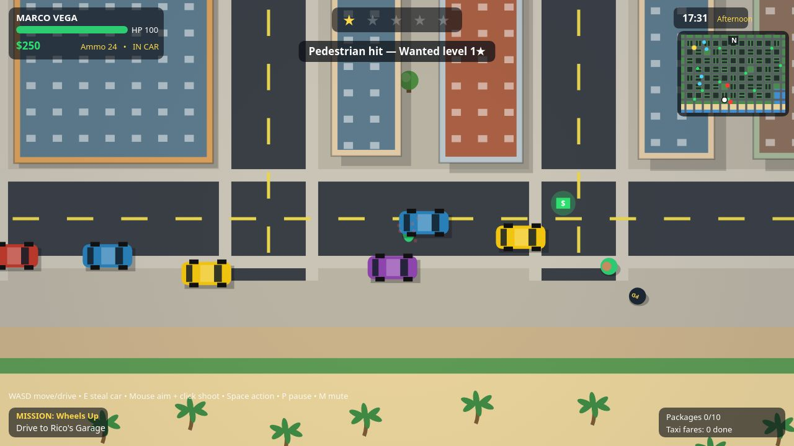
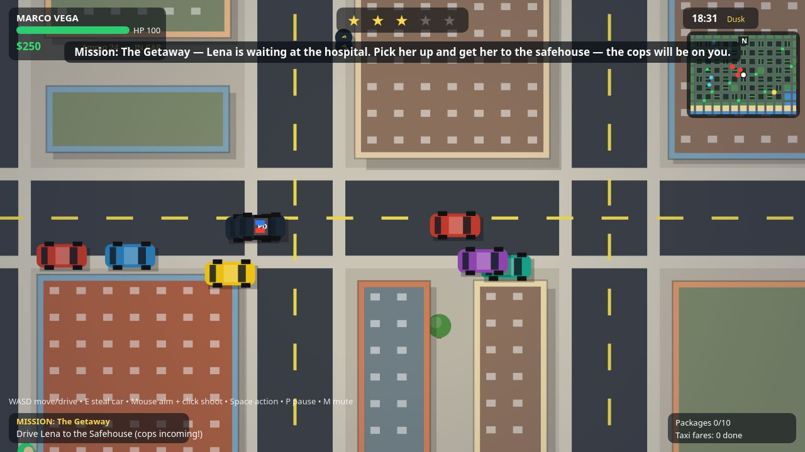

# 🌴 Solmar Bay — Open-World Crime Game


▶️ **[Play it live](https://kamalmosadegh.github.io/solmar-bay/game/)** — an original top-down open-world game in your browser.




## 🎮 Features
- **A living city:** traffic with real lane behaviour, wandering pedestrians
- **Car theft** and a **5-star wanted system** — police AI that hunts you down
- **6 missions**, a minimap HUD and a **persistent save system**
- Synthesized engine, siren and city sounds (WebAudio) — zero audio assets

Built in a single day for a make.fun GTA VI bounty ($1,666 pool, 1,642 entries).

## 🗂️ Structure
Modular vanilla-JS source under `game/src/` — `city` · `traffic` · `police` · `missions` · `combat` · `hud` · `save` · `render`.

## 🚀 Run locally
```bash
python3 -m http.server   # then open /game/
```

## 👤 Author
**Kamal Mosadegh** — freelance developer · [Portfolio](https://kamalmosadegh.github.io) · kamalmosadegh6977@gmail.com

MIT licensed.
